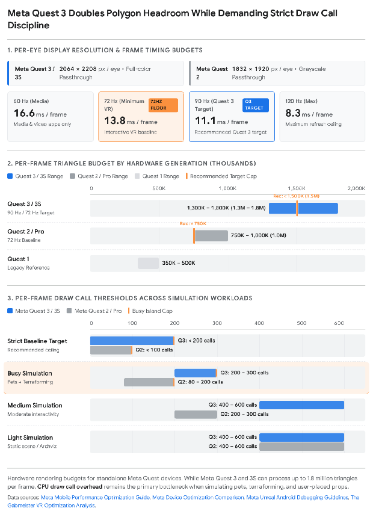
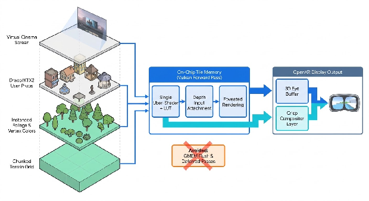
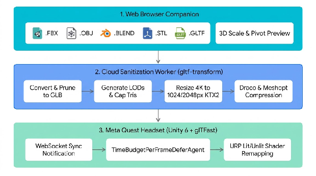

# **Executive Blueprint: High-Fidelity Meta Quest Island World-Builder**

Building a visually stunning, one-acre island sandbox on standalone Meta Quest hardware requires subverting the conventional mobile VR rendering pipeline. Most standalone VR applications look washed-out, blocky, and aliased because developers treat the headset like a scaled-down desktop PC—relying on standard lit shaders, dynamic shadows, unbatched draw calls, and heavy post-processing that choke mobile tile-based GPUs1. By constraining your playable world to a single one-acre island (approximately 4,047 square meters, modeled as a 64m × 64m landmass surrounded by water), you gain a decisive architectural advantage: a bounded spatial footprint where memory, draw calls, and lighting can be tightly managed to deliver lush foliage, real-time terraforming, autonomous pets, live streaming media, and user-uploaded 3D models at a stable 72 to 90 frames per second (FPS)4.  
To achieve high visual fidelity without overheating the headset or dropping frames, the application should be engineered on **Unity 6 (6000.x LTS)** using the **Universal Render Pipeline (URP)** over the **Vulkan API** with the **Render Graph** system and **Forward Rendering**3. Counterintuitively, Unity's official XR optimization documentation advises developers to **avoid using Unity 6's GPU Resident Drawer** on untethered devices like Meta Quest, because it introduces additional GPU overhead that lowers overall frame rates unless a scene is strictly CPU-bound3. Instead, visual richness is achieved by combining **2X Multisample Anti-Aliasing (MSAA)**3, **OpenXR Foveated Rendering** (which industry estimates from Game-Ace indicate frees 15% to 25% of GPU headroom on Quest 3)3, **OpenXR Compositor Layers** for sharp media screens and UI7, dynamic **Application SpaceWarp (AppSW)** during heavy terrain sculpting3, and **GPU-instanced, vertex-colored shaders** that collapse hundreds of flower, bush, and tree varieties into a small number of draw calls1.  
Equally important are the architectural guardrails required for your three signature features: external 3D model ingestion, virtual TVs/projectors, and the Spotify box radio. First, as documented in glTFast production reports analyzed by OptimizeGLB, allowing users to load unoptimized 3D files with embedded 4K textures directly onto Android-class hardware consumes excessive decoded memory and causes crashes13; therefore, your **Browser Companion** must act as an automated cloud sanitization gateway that converts uploads (from .fbx, .obj, .blend, or .stl) into compressed .glb files using **1024px or 2048px KTX2/Basis Universal** textures and **Draco or Meshopt** geometry compression before streaming them to the headset via Unity's **glTFast** runtime loader13. Second, while embedded **Vuplex 3D WebView (GeckoView)** with Widevine DRM enabled can stream YouTube, Vimeo, and standard web video onto virtual TVs, **Netflix and services requiring Widevine Verified Media Path (VMP) cannot play inside embedded Unity webviews** on Android16; supporting those services requires a dedicated native Quest OS multitasking overlay workflow. Third, while the **Spotify Web Playback SDK** can turn an in-game radio into an active Spotify Connect player, it requires a **Spotify Premium** subscription and **must not be used in commercial projects without Spotify's prior written approval**, making a dual-mode Spotify Web API remote controller plus internet radio receiver essential for a commercial release17.

## **Hardware Performance Budgets and the Visual Fidelity Breakthrough**

To understand why many standalone VR titles look poor—and how to make your island look crisp and vibrant—you must design directly around the hardware budgets of the tile-based GPUs inside the Meta Quest 2, Quest 3S, and Quest 3. According to Meta's official developer documentation, every interactive VR frame must complete all CPU and GPU work within **13.7 to 13.9 milliseconds for 72 FPS** (the minimum interactive requirement, vs. 16.6 ms for 60 FPS media apps), **11.1 ms for 90 FPS** (recommended for Quest 3), or **8.3 ms for 120 FPS**4.  

As Meta's hardware guidelines and VR developer benchmarks demonstrate, **raw triangle count is rarely the primary bottleneck when a standalone VR application stutters**1. Meta Quest 3 and 3S can render **1.3 million to 1.8 million triangles per frame** (with a strict recommended baseline below 1.5M), and Quest 2 handles **750,000 to 1 million triangles** (recommended baseline below 750K)5. Instead, standalone VR worlds fail visually and thermally because of three compounding rendering bottlenecks: **CPU draw call saturation from pipeline state changes**, **tile-memory flushes to system RAM (GMEM loads)**, and **fragment shader overdraw**1.

### **The Physics of Draw Calls and Tile-Based Mobile GPUs**

In a world-builder where a user places hundreds of flowers, bushes, trees, and custom furniture pieces, a naive implementation submits each object as an individual draw call with its own material. Meta's official draw call analysis and VR engineering benchmarks reveal why this approach degrades frame rates:  
First, **shader and material switching penalties** dominate CPU render thread time. According to Meta's Unity draw call benchmarks, switching shader programs between draw calls increases the CPU time cost of that draw call by **175%**2. Conversely, redrawing the exact same object and material state costs only **25% as much** as drawing a different object2. While changing a material's color property alone carries minimal overhead if materials are already being swapped, using a single shared material and encoding color variations directly into mesh vertex data allows the entire group to batch or instance together1. As experienced VR developers note, a thousand 50-triangle objects each with its own material can cost more frame time than a single 50,000-triangle mesh1.  
Second, **tile boundary vertex multiplication** penalizes oversized or poorly subdivided geometry. Quest GPUs divide the high-resolution eye buffers (2064 × 2208 per eye on Quest 3; 1832 × 1920 per eye on Quest 25) into small on-chip memory tiles. Meta's Unreal and Unity documentation notes that when a triangle spans multiple GPU tiles, its vertex shader runs **three times (once per vertex) for every single tile it covers**2. Huge, un-subdivided terrain polygons or large screen-filling meshes statistically cover more tiles and multiply vertex shader load2.  
Third, **linear-space alpha blending and overdraw** exhaust pixel fill-rate. In VR, large transparent surfaces—such as water planes, glass panels, blob shadows, or world-space UI—quietly consume fill rate at double eye-buffer resolution1. Meta's GPU cost analysis highlights that alpha blending in Linear color space is particularly expensive because every sampled color has a gamma curve applied on read and reversed when written back, forcing a much higher blending cost than staying in sRGB or using opaque geometry2.

### **The 7-Pillar Visual Optimization Architecture for Your Island**

To achieve vibrant aesthetics while keeping frame times inside the 13.8 ms (72 Hz) or 11.1 ms (90 Hz) budget4, your rendering pipeline should enforce seven architectural pillars grounded in Unity 6 and Meta Quest documentation:

| Optimization Pillar | Exact Configuration & Engine Setting | Why It Prevents Cooking the Headset & Boosts Visuals |
| :---- | :---- | :---- |
| **1. Graphics API & Pipeline** | **Unity 6 URP** + **Vulkan API** + **Render Graph** + **Forward Rendering** + **Single-Pass Stereo (Multi-View)**2. | Vulkan provides superior stability and performance over OpenGL ES3. Forward rendering avoids the multiple G-buffer render targets of Deferred rendering, which force tile-based GPUs to perform slow graphics memory (GMEM) loads3. |
| **2. Draw Call Batching Strategy** | **Disable GPU Resident Drawer**3. Enable **SRP Batcher**, **GPU Instancing**, and **Static/Manual Mesh Combining** for placed island groups12. | Unity 6 documentation explicitly advises avoiding GPU Resident Drawer on untethered XR devices because its compute/Forward+ overhead lowers frame rates unless strictly CPU-bound3. Instanced rendering and mesh batching keep draw calls within the <200 (Quest 3) and <100 (Quest 2) baseline targets5. |
| **3. Unified Shaders & Vertex Colors** | Minimize shader variants18. Store color variations in **Mesh Vertex Colors** and sample a **Look-Up Table (LUT)** or **ASTC Texture Atlas**1. | Avoids the 175% CPU shader-switching penalty2. Meta's GPU tests show dependent texture reads on Quest are only slightly more expensive than independent reads, making LUT sampling a cheap replacement for complex fragment math2. |
| **4. Lighting & Shadow Discipline** | Minimize dynamic lights and disable dynamic shadows on foliage1. Use **1 baked lightmap atlas**, **Spherical Harmonics (SH) Light Probes** (without box projection/blending), and at most **1 shadow cascade**1. | Every dynamic light adds GPU cost for every fragment touched, and even default lit shaders run full lighting paths1. Baking lighting impressions into vertex colors with unlit/LUT shaders drops GPU frame time dramatically1. |
| **5. Depth & Buffer Management** | **Disable Depth Priming**, **Disable Opaque Texture**, **Disable Depth Texture**, **Disable HDR**, **Disable SSAO**3. Use a Vulkan **Depth Input Attachment** when pixel depth is needed3. | Depth priming doubles depth pre-pass cost across two VR eyes when hardware Low-Resolution-Z (LRZ) and Hidden Surface Removal (HSR) already handle occlusion3. Depth Input Attachments read depth on-tile without copying depth buffers to video memory3. |
| **6. Anti-Aliasing vs. On-Tile Post-Processing** | **Option A:** **2X MSAA** enabled, Post-Processing disabled3. **Option B (Unity 6.3+):** **On-Tile Post-Processing** (requires disabling MSAA) or **STP Upscaler**3. | 2X MSAA runs efficiently on tile-based GPUs in Forward rendering3. Because MSAA breaks on-tile rendering, standard post-processing should be disabled (or replaced with Unity 6.3+ on-tile post-processing without MSAA)3. |
| **7. OpenXR Hardware Accelerators** | Enable **Foveated Rendering**, **Multiview Render Regions**, **Adaptive Performance Basic Provider** (Unity 6.6+), and optional **Application SpaceWarp (AppSW)**3. | Foveated rendering reduces peripheral pixel shading to free an estimated **15%–25% of GPU headroom** on Quest 36. AppSW renders at half frame rate using motion vector and depth buffers, boosting effective frame rates by up to **70%**10. |

### **Runtime Profiling and Dynamic Hardware Scaling**

As VR archviz optimization studies emphasize, running a profiler inside the desktop Editor skews metrics and can make draw calls appear 2 to 3 times higher than expected; all profiling must be performed on the target Quest hardware19. Use **Meta Quest Developer Hub**, **OVR Metrics Tool**, **Meta Quest Runtime Optimizer**, and **RenderDoc Meta Fork** to diagnose bottlenecks4. When testing on-device at a 72 FPS target (13,800 microseconds per frame), OVR Metrics' **APP T** metric immediately distinguishes GPU from CPU bottlenecks19:

* **If APP T > 13,800 µs and FPS < 72**: The application has a **100% GPU bottleneck** (CPU may also be over budget but is masked by the GPU)19.  
* **If APP T < 13,800 µs and FPS < 72**: The application has a **100% CPU bottleneck**19.

In addition, use runtime device detection to scale quality automatically between Quest 2 and Quest 35. On Quest 2, apply a lower render resolution scale, use lower-resolution textures or fewer mip levels, disable post-processing, and enforce a tighter draw call limit (<100 to 200 draw calls at 72 Hz)5. On Quest 3, leverage its expanded memory headroom and GPU compute to run at 90 Hz with higher render resolution targets, full texture mipmaps, depth API/passthrough support if desired, and up to 200–300 draw calls during busy simulation5.

## **Terraforming, Foliage Engine, and the Pre-Loaded Island Inventory**

When the player first spawns into the app, they stand on flat, tan ground measuring one acre (4,047 m², architected as a **64m × 64m buildable terrain grid** with a rounded shoreline inside a surrounding ocean plane). To maximize performance, VR rendering guidelines recommend removing all volumetric effects such as volumetric clouds and raymarched fog, replacing them with a static high-resolution skybox paired with localized fog or **Vertex Fogging for Opaque** at the distant horizon19.

### **Real-Time Terraforming Architecture (Hills, Mountains, Grass, and Astroturf)**

To let users sculpt hills, mountains, valleys, and ponds smoothly without triggering tile-spanning triangle penalties2 or multi-pass terrain splatmap overhead, we recommend designing a **Custom Chunked Heightmap Mesh System** tailored to the 64m × 64m island:

> 1. **Chunked 8×8 Terrain Grid**: Divide the 64m × 64m island into **64 terrain chunks** of **8m × 8m** each. At a 25cm vertex spacing (33 × 33 vertices = 2,048 triangles per chunk at LOD0), the entire one-acre landmass requires ~131,000 triangles at full resolution—well under Quest 2's 750K and Quest 3's 1.5M triangle budgets5—while keeping individual triangles compact so they do not span multiple GPU tiles2.  
> 2. **Asynchronous Sculpting Brushes**: When the user aims their VR controller to raise hills, push up mountains, flatten building pads, or carve water channels, modify only the heightmap vertices of the 1 to 4 chunks intersected by the brush radius. Defer physics MeshCollider cooking until the user releases the trigger to keep CPU frame times smooth.  
> 3. **Vertex-Channel Terrain Shading**: Instead of multi-pass splatmap shaders, store terrain surface weights in the mesh's **Vertex Color channels (RGBA)** and sample a global texture array1: Red for the initial flat Tan Ground/Sand, Green for Grass or Astroturf, Blue for Mountain Cliff Rock (blended automatically on steep slopes), and Alpha for Garden Paths.  
> 4. **Lush Grass vs. Astroturf Modes**: For **Astroturf**, apply a zero-polygon micro-normal and sheen LUT directly onto the Green vertex channel of the terrain mesh2. For **Natural Grass**, combine that base layer with GPU-instanced opaque grass blade clusters rendered near the player1.  
> 5. **On-Tile Shoreline Water**: Render the surrounding water as a single mesh using a **Vulkan Depth Input Attachment**3. Because Depth Input Attachments read pixel depth directly in tile memory without copying the depth buffer to video memory3, the water shader can automatically draw a crisp foam ring wherever newly terraformed hills or beaches meet the water at minimal GPU cost.

### **The VR Foliage Engine: Rendering Hundreds of Flowers and Dozens of Trees**

Foliage is a central pillar of your vision—hundreds of flower types, dozens of tree types, and dozens of bush types—and also one of the classic performance traps in VR1. Traditional 3D games render leaves and petals by placing semi-transparent textures onto simple 2-triangle square cards. In VR, overlapping transparent cards generate severe **overdraw** at double eye-buffer resolution1.  
To render a botanical paradise on Meta Quest without frame drops, your foliage pipeline should implement six specific VR optimization techniques documented in VR archviz and Meta performance guides1:

> 1. **Add Triangles to Eliminate Transparency**: As VR archviz optimization guides explicitly recommend, *add more triangles to the foliage mesh* so the geometry closely hugs the leaf or flower silhouette19. Because Quest GPUs can process hundreds of thousands of triangles easily while struggling with transparent overdraw1, modeling a flower cluster with 40–80 opaque triangles instead of transparent quads makes the plant look genuinely 3D while reducing transparent pixels and overdraw1.  
> 2. **Avoid Transparency and Alpha Blending**: Avoid standard transparency and alpha clipping where possible1. Use fully opaque meshes with vertex color gradients1.  
> 3. **Procedural Species Variety via Vertex Colors & LUTs**: Meta's CPU/GPU cost analysis shows that switching shaders or materials carries heavy penalties, whereas using a single shared material and encoding color changes in mesh vertex data or sampling a Look-Up Table (LUT) is highly efficient1. By modeling **32 distinct botanical flower meshes** and driving **10 color/gradient cultivar palettes per mesh via GPU Instancing and Vertex Colors**, you deliver **320 distinct flower types** using **1 unified material**1.  
> 4. **Disable World Position Offset (WPO) and Dynamic Shadows**: VR foliage optimization guidelines specifically instruct developers to **disable dynamic shadows** (or use a very short shadow culling distance) and **disable World Position Offset (WPO)** wind animation in foliage materials19. Use static baked ambient occlusion in the vertex colors and subtle ground blob decals instead1.  
> 5. **Increase Foliage Size While Reducing Density**: Scaling bushes and flower clusters up by 15%–20% while reducing instance count creates a fuller, more lush visual canopy with significantly fewer polygons and draw calls19.  
> 6. **Aggressive Custom LODs and Billboards**: Generate aggressive Level of Detail (LOD) chains and distant billboards, and tune cull distances carefully19. In documented VR optimization cases, adding custom LODs reduced scene triangle counts from 11,000,000 down to 300,000—though artists must inspect auto-generated LODs manually so delicate silhouettes (like flower tops or vases) do not break19.

### **Proposed Pre-Loaded Island Inventory Taxonomy (550+ Items)**

So that users can immediately build expansive islands without needing external 3D files on Day 1, we recommend structuring a **Pre-Loaded Island Inventory of 630+ modular items** packed into shared texture atlases1 with the following design specifications:

| Inventory Category | Proposed Pre-Loaded Count | Included Sub-Types & Modular Varieties | Recommended Triangle Target (LOD0 → LOD2) | Batching & Shader Strategy |
| :---- | :---- | :---- | :---- | :---- |
| **1. Trees (Dozens of Types)** | **36 Species** | **Tropical (9):** Coconut Palm, Royal Palm, Banana Tree, Banyan, Mangrove, Plumeria, Pandanus, Traveler's Palm, Dragon Blood. **Temperate & Deciduous (12):** Ancient Oak, Weeping Willow, Silver Birch, Japanese Red Maple, Ginkgo Biloba, Cherry Blossom (Sakura), Beech, Jacaranda, Magnolia, Poplar, Elm, Chestnut. **Alpine & Conifer (8):** Blue Spruce, Douglas Fir, Scots Pine, Italian Cypress, Giant Sequoia, Cedar of Lebanon, Larch, Juniper. **Arid & Sculptural (7):** Baobab, Joshua Tree, Olive Tree, Acacia, Saguaro Cactus, Eucalyptus, Giant Sculptural Bonsai. | 1,200 → 180 tris (plus distant billboard)19 | GPU Instanced per species mesh5; shared Botanical Atlas1; dynamic shadows and WPO disabled19. |
| **2. Bushes, Shrubs & Hedges** | **42 Species** | **Flowering Shrubs (14):** Azalea, Rhododendron, Bougainvillea, Camellia, Hibiscus Bush, Oleander, Forsythia, Lilac, Peony Shrub, Gardenia, Fuchsia, Lantana, Spiraea, Wisteria. **Foliage & Topiary (16):** Boxwood Hedge (Straight, Corner, Arch, Sphere, Spiral, Pyramid), Privet, Holly, Juniper Bush, Nandina, Photinia, Euonymus, Pittosporum, Barberry. **Ferns & Grasses (12):** Boston Fern, Staghorn Fern, Monstera, Elephant Ear (Alocasia), Pampas Grass, Bamboo Clump (Green, Golden, Black), Agave, Aloe Vera, Yucca, Hosta. | 450 → 60 tris | High-triangle opaque silhouettes to eliminate transparent overdraw1; GPU instanced with vertex color tinting1. |
| **3. Flowers & Groundcover** | **320 Varieties** | **32 Base Botanical Meshes × 10 Vertex-Color/LUT Cultivars:** Roses (Climbers, Bushes, Singles), Tulips, Sunflowers, Orchids, Hydrangeas, Lavender, Bird of Paradise, Lotus & Water Lilies (for ponds), Poppies, Daisies, Dahlias, Marigolds, Foxgloves, Lupines, Iris, Daffodils, Hyacinths, Chrysanthemums, Carnations, Zinnias, Snapdragons, Begonias, Petunias, Pansies, Hibiscus, Plumeria Blossoms, Protea, Calla Lilies, Anemones, Bluebells, Clover Patches, Wildflower Clusters. | 80 → 16 tris per cluster | Single material with GPU Instancing on; color stored in vertex data / LUT1. |
| **4. Gazebos, Pergolas & Pavilions** | **28 Prefabs** | Victorian Wrought-Iron Gazebo, Cedar Octagonal Gazebo, Japanese Tea Pavilion, Balinese Thatch Bale, Modern Louvered Pergola, Classical Greek Rotunda, Moroccan Courtyard Pavilion, Rustic Timber Cabana, Glass Conservatory (using opaque frames + Cubemap/MatCap reflections instead of alpha blending2). | 2,500 → 400 tris | Modular snapping; Static Batching or runtime mesh combining once placed12. |
| **5. Modular Buildings & Architecture** | **95 Modules** | **5 Architectural Themes (Tropical Villa, Modern Concrete/Wood, Cozy Cottage, Japanese Ryokan, Mediterranean Stucco):** Foundations, Walls, Windows, Doors, Sloped/Flat/Thatch Roofs, Stairs, Balconies, Decks, Docks, Piers, Bridges (Rope, Stone Arch, Zen Bridge), Lighthouses, Walkways. | 200 → 40 tris per module | Modular environment art shares 1 Architectural Atlas and combines contiguous static parts into single calls12. |
| **6. Decorations, Rocks & Live Props** | **110 Items** | **Rocks & Boulders (20):** Granite, Basalt Columns, Sandstone Arch, Mossy River Stones, Stepping Stones. **Outdoor Living (75):** Lounge Chairs, Hammocks, Dining Sets, Fire Pits, Tiki Torches, Stone Lanterns, Fountains, Statues, Planters, Fences, Trellises. **Live Media & Pet Props (15):** Spotify Box Radio, Retro Boombox, Drive-In Cinema Screen, Wall Flatscreen TV, Portable Projector, Pet Houses, Agility Hoops, Food Bowls, Fetch Balls. | 150 → 40 tris | Shared Prop Atlas; decorative lights use baked vertex/lightmap glow rather than real-time dynamic lights1. |

## **Dual-Track UX Architecture: Simple Toybox Meets Full-Scale Artist Studio**

To make the island feel immediately "simple and fun" for casual sessions while offering the expansive creative depth of massive *Minecraft* builds on a single one-acre island, we recommend structuring the user interface around **Progressive Disclosure and Dual Scale Modes**:

### **Mode 1: "Simple & Fun" Toybox Mode (Default Experience)**

In Toybox Mode, players can pinch and pull with both VR controllers to shift effortlessly between **1:1 First-Person Scale** (walking along the beach, sitting in a gazebo, playing with pets) and a miniature **Tabletop Diorama Scale** (where the entire one-acre island floats at waist height for effortless macro-sculpting). Instead of placing flowers one by one, a **"Scatter & Grow" Foliage Brush** lets users paint mixed botanical meadows across hills with a sweep of their hand, automatically spacing trees, bushes, and flowers while scaling up plant sizes slightly to create dense visual volume with fewer instances19. Dropping a gazebo or cottage onto a sloped hill automatically levels a circular foundation pad or extends support stilts into the water.

### **Mode 2: "Full-Scale Artist Studio" (Minecraft-Depth Power Tools)**

Toggling **Studio Mode** on the user's wrist menu unlocks fine-grained architectural and artistic tools:

* **Multi-Resolution Snapping Grids & Gizmos**: Artists can lock modular building pieces and uploaded 3D items to a 1m, 50cm, 25cm, or 5cm 3D grid with precise axial translation, rotation, and scale handles.  
* **Kitbashing & Runtime Mesh Welding**: Just as *Minecraft* builders assemble massive structures from modular blocks, artists can combine dozens of pre-loaded walls, rocks, and uploaded 3D models into custom architectural assemblies. To prevent these intricate creations from exhausting the draw call budget, grouping an assembly triggers a background mesh combiner that welds static meshes sharing the same material into a single draw call1.  
* **Runtime glTF Scene & Prefab Export**: Because Unity's **glTFast** package supports **Runtime Export** in addition to runtime import25, artists can export any custom kitbashed creation—or a 3D snapshot of their entire one-acre island—as a standard .glb file to share, remix in Blender, or back up via the Browser Companion26.  
* **Live "Island Budget" Wrist Gauge**: Modeled directly on the thresholds of the **Meta Quest Runtime Optimizer** (Green = below 80% of target budget, Yellow = 80%–95% approaching budget, Red = above 95% over budget)24, a sleek indicator on the artist's wrist displays current draw call, triangle, and texture memory headroom so creators can push the hardware to its limits safely.

## **Cloud Browser Companion and Universal 3D Asset Ingestion Pipeline**

Enabling users to bring in 3D models from *any* 3D modeling software (Blender, Maya, 3ds Max, ZBrush, SketchUp, Rhino) via a **Browser Companion** is a cornerstone of your app—and requires careful engineering to protect headset stability. If an application downloads raw, unoptimized 3D models directly to a standalone headset, two documented failure modes occur, as highlighted in OptimizeGLB's analysis of glTFast runtime issues13:

> 1. **Download Transfer Delays (glTFast Issue #219)**: In unoptimized runtime loads, roughly **90% of import time is spent downloading** bloated geometry and uncompressed textures13.  
> 2. **Android 4K Texture Memory Crashes (glTFast Issue #552)**: Loading GLBs with large embedded 4K textures consumes unexpectedly high decoded pixel memory and **crashes on Android-class hardware**13.

### **The Solution: Cloud Sanitization Gateway + glTFast Runtime Streaming**

To accept any 3D file type seamlessly while guaranteeing that user uploads never overheat or crash the Quest, all format conversion, polygon simplification, and texture compression should run **in the cloud** inside your Browser Companion backend before the headset downloads the asset13.  

### **End-to-End Ingestion Architecture**

> 1. **Web Browser Companion & Scale Normalization**: Users log into your web companion portal and drag-and-drop files from any 3D tool (.fbx, .obj + .mtl, .blend, .stl, .dae, .gltf, or .glb)14. Because Unity's glTFast package does not provide a built-in default import scale setting like Unity's Editor model importer28, the Browser Companion displays a 3D preview next to a 1.8m human reference figure so the user can normalize units (e.g., millimeters to meters) and pivot alignment before clicking "Send to Island."  
> 2. **Cloud Conversion & gltf-transform Optimization**: On the server, headless conversion tools (such as Blender CLI and Assimp) convert non-glTF formats into .glb, and **gltf-transform**14 executes a strict four-part optimization pass based on glTFast compatibility guidelines13:  
   * **Prune & Deduplicate**: Removes unused nodes, duplicate accessors, and redundant materials13.  
   * **Mesh Simplification vs. Compression**: Because Draco compression reduces file transfer size but does *not* reduce runtime triangle count13, the cloud worker generates a simplified runtime mesh and LOD chain (and inspects skins, morph targets, and silhouettes)13.  
   * **Texture Capping & KTX2 Transcoding**: All oversized 4K/8K textures are capped at **1024px or 2048px** based on visual need and transcoded to **KTX2 / Basis Universal (KHR_texture_basisu)**13. **Avoid WebP textures**, as current glTFast releases explicitly report unsupported WebP without a custom add-on13.  
   * **Draco / Meshopt Geometry Compression**: Applies **Draco (KHR_draco_mesh_compression)** or **Meshopt (EXT_meshopt_compression)** to shrink network download times13.  
> 3. **Stutter-Free On-Device Loading (glTFast + TimeBudgetPerFrameDeferAgent)**: Inside Unity 6, install **com.unity.cloud.gltfast**, **com.unity.cloud.ktx**, **com.unity.cloud.draco**, and **com.unity.meshopt.decompress**14. Note that because KHR_draco_mesh_compression and KHR_texture_basisu have no uncompressed fallback inside the .glb file, **Draco for Unity and KTX for Unity must be installed and validated in every target build**13. Always pass an ICodeLogger (such as ConsoleLogger) to GltfImport during development, because glTFast disables logging altogether if no logger is provided and returns true even on partially loaded scenes (such as a failed texture load)15.  
> 4. **Preventing Main-Thread Freezes**: According to glTFast's official runtime documentation, loading complex glTF scenes or multiple files at once with the default UninterruptedDeferAgent can block the main thread for up to multiple seconds15. Instead, pass a shared **TimeBudgetPerFrameDeferAgent** to all GltfImport instances so work is spread across game loop iterations for a stable frame rate15. If your users need advanced glTF material extensions beyond standard URP Lit/Unlit (such as KHR_materials_transmission for glass, KHR_materials_clearcoat, KHR_materials_sheen for fabric, or KHR_materials_iridescence), **UnityGLTF** (pure C#) and **glTFast** can coexist in the same Unity project14.

## **Live Media Architecture: Spatial Spotify Box Radio and Virtual Cinema Screens**

Working on an island build becomes deeply relaxing when you can place a box radio playing Spotify on a picnic table and mount a projection screen between palm trees to watch movies or TV shows. However, implementing live streaming media on standalone Android VR requires navigating specific DRM, browser engine, and SDK licensing rules16.

### **Virtual TVs, Projectors, and Screens (Video & Web Media)**

To render interactive web video onto 3D TVs and projectors on Meta Quest, use **Vuplex 3D WebView for Android with Gecko Engine (AndroidGeckoWebView)**, which embeds Mozilla's GeckoView engine modified via geckoview-mods to remove Google Mobile Services references for compatibility with non-GMS Android devices like Meta Quest16.

> 1. **Enabling Widevine DRM**: By default, DRM is disabled in 3D WebView because it could potentially be used for tracking16. To enable Widevine DRM in the Gecko Engine package, call AndroidGeckoWebView.SetDrmEnabled(true) at application startup (or AndroidWebView.SetDrmEnabled(true) if using the standard Android system webview package)16:  
>    C#  
>    void Awake() {  
>        #**if** UNITY_ANDROID && !UNITY_EDITOR  
>            AndroidGeckoWebView.SetDrmEnabled(true);  
>        #**endif**  
>    }

>    Once enabled, verify DRM playback by loading a DRM Stream Test page inside the webview16.  
> 2. **The Netflix & Verified Media Path (VMP) Limitation — And How to Address It**: According to Vuplex's official Widevine documentation, **even with Widevine DRM enabled, video streaming sites like Netflix will not play in 3D WebView** because Netflix requires explicit approval via **Verified Media Path (VMP)**16. Neither Android's system webview (android.webkit.WebView) nor embedded GeckoView supports Widevine VMP16.  
   * **What Plays Directly on In-World 3D WebView TVs**: YouTube (full resolution on Android GeckoView; note that the 360p fallback video limitation applies only to iOS and visionOS when Native 2D Mode is disabled16), Vimeo, Facebook video, standard HTML5 <video> streams, home media servers (Plex/Jellyfin web interfaces), and local video files played via Unity's native VideoPlayer.  
   * **Architectural Workaround for Netflix / VMP Services**: Provide two clean options on the virtual TV remote: (a) **PC/Mac Companion Screen Cast**, allowing the user's Browser Companion tab to stream a desktop browser window into the island TV via WebRTC, or (b) **Native Quest OS Window Docking**, allowing the user to pop up the native Meta Quest Browser (which has OS-level VMP certification) aligned with their in-world cinema screen.  
> 3. **Eliminating Blur and SpaceWarp Artifacts via OpenXR Compositor Layers**: Both Meta's Application SpaceWarp documentation and Unity 6's XR documentation highlight the value of **Compositor Layers**7. Rendering text, video, and UI on native runtime compositor layers makes text and video appear much sharper with clearer outlines and prevents them from being warped by Application SpaceWarp7. Note one important caveat from Meta's documentation: if a compositor layer sits *within* the 3D scene such that controllers or objects pass in front of it, you must enable "support depth" on the compositor layer, which removes transparency effects and can cause minor artifacts around the layer's perimeter7. For secondary transparent UI widgets rendered in normal world space while AppSW is active, assign a custom material with "Output depth and velocity" checked so opaque objects passing behind the UI do not "pull" the pixels7.

### **The Spatial Box Radio (Spotify Integration Architecture)**

For the in-world Box Radio, Spotify's documentation establishes clear technical and legal boundaries17:

| Integration Approach | Technical Implementation on Meta Quest | Requirements & Limitations | Commercial Licensing Status |
| :---- | :---- | :---- | :---- |
| **Option 1: Spotify Web Playback SDK** | Loaded inside a hidden AndroidGeckoWebView with AndroidGeckoWebView.SetDrmEnabled(true) and iframe encrypted-media + autoplay permissions16. Creates a Spotify Player instance controllable via **Spotify Connect**17. | Requires a **Spotify Premium subscription** (mobile-only premium tiers are excluded)17. User must interact with an in-world button to trigger playback17. | **Requires Written Approval for Commercial Use:** Spotify's documentation explicitly states: *"This SDK must not be used in commercial projects without Spotify's prior written approval"*17. |
| **Option 2: Spotify Web API Remote + Spatial Internet Radio Streams** | Box Radio authenticates with the **Spotify Web API** to display track metadata and control the user's active Spotify Connect device, while also offering built-in **Icecast/MP3 internet radio streams** routed directly into a 3D spatialized Unity AudioSource. | Built-in radio streams require no subscription and support full 3D distance attenuation on the island; Spotify remote controls any logged-in Spotify client. | **Commercial-Ready Baseline:** Avoids commercial restrictions on the Web Playback SDK17 while still giving users full in-world Spotify control and spatial island music. |

## **Autonomous Pet Generation, Customization, and Harmony AI**

To allow users to generate, design, and name custom pets that live in harmony and play together without pushing the headset out of its **200–300 draw call Busy Simulation budget** on Quest 3 (or **80–200 draw calls** on Quest 2)18, the pet subsystem should be engineered around four optimization principles:

> 1. **Parametric Pet Studio with BlendShapes and Single-Material Coat Masks**: Both Unity and glTFast/UnityGLTF natively support **Skinned Mesh Renderers** and **Blend Shapes** (morph targets)14. By creating 6 to 8 base pet archetypes (e.g., Dog, Cat, Island Fox, Capybara, Red Panda, Miniature Dragon) with morph sliders for ears, snout, tail, and body proportions, users can design unique body shapes without adding extra meshes. To avoid material-switching CPU costs2, use a single shared pet shader where coat patterns, markings, and eye colors are driven by per-instance vertex/material color properties1, and render the pet's custom name onto an opaque collar tag or unlit vertex-baked badge rather than a heavy multi-pass world-space UI panel1.  
> 2. **GPU Compute Skinning**: Unity 6 introduces **GPU (Compute) Skinning**9, which offloads skeletal mesh deformation from the CPU onto the Vulkan GPU while maintaining high frame rates9.  
> 3. **Disable "Always Animate"**: VR optimization benchmarks specifically recommend turning off **"Always Animate"** in Unity's Animator component (setting culling to Cull Completely when off-screen), as animating off-screen characters needlessly consumes CPU frame time1.  
> 4. **Low-Frequency Harmony Coordinator & Localized NavMesh**: Rather than running individual per-frame pathfinding searches, a central PetHarmonyCoordinator can evaluate pet states at a low tick rate (e.g., 4 times per second) over a chunked NavMeshSurface that rebakes only the specific 8m × 8m terrain chunk modified after terraforming. Pairing pets into synchronized interaction sockets (playing chase/tag around trees, fetching user-uploaded 3D toys, or napping together near the Box Radio) creates emergent harmony at negligible CPU cost.
